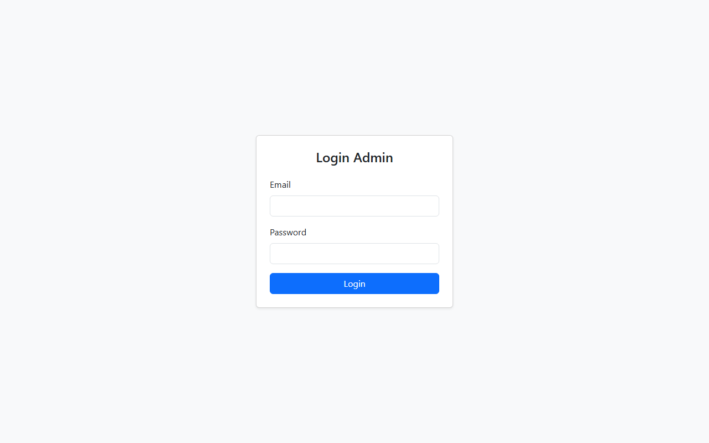
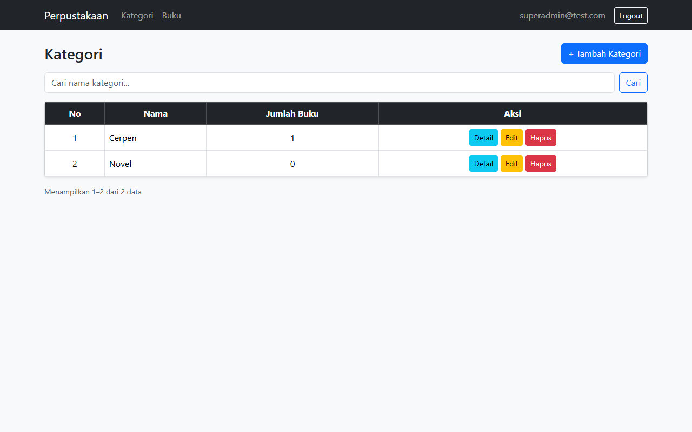
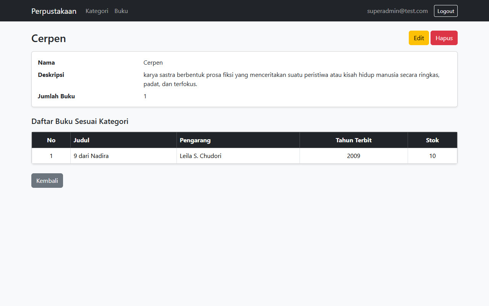
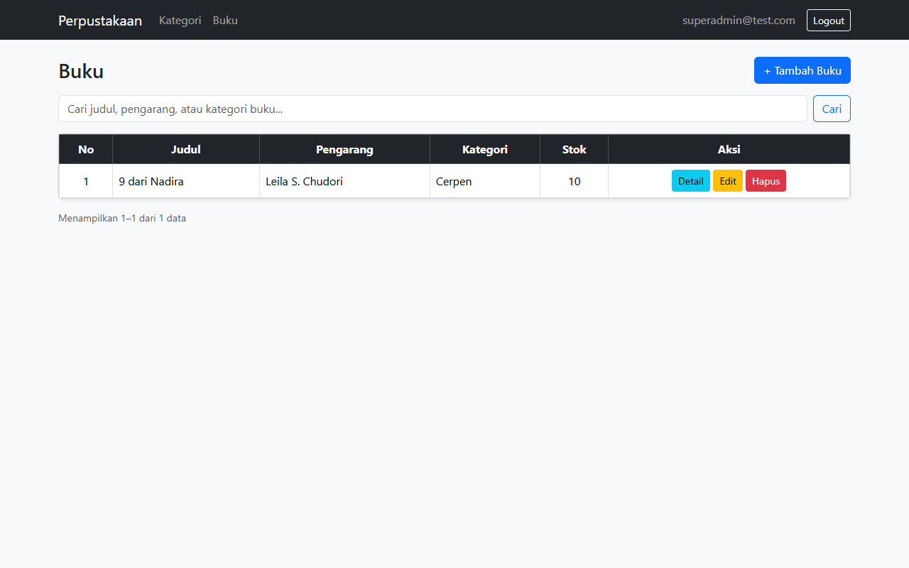
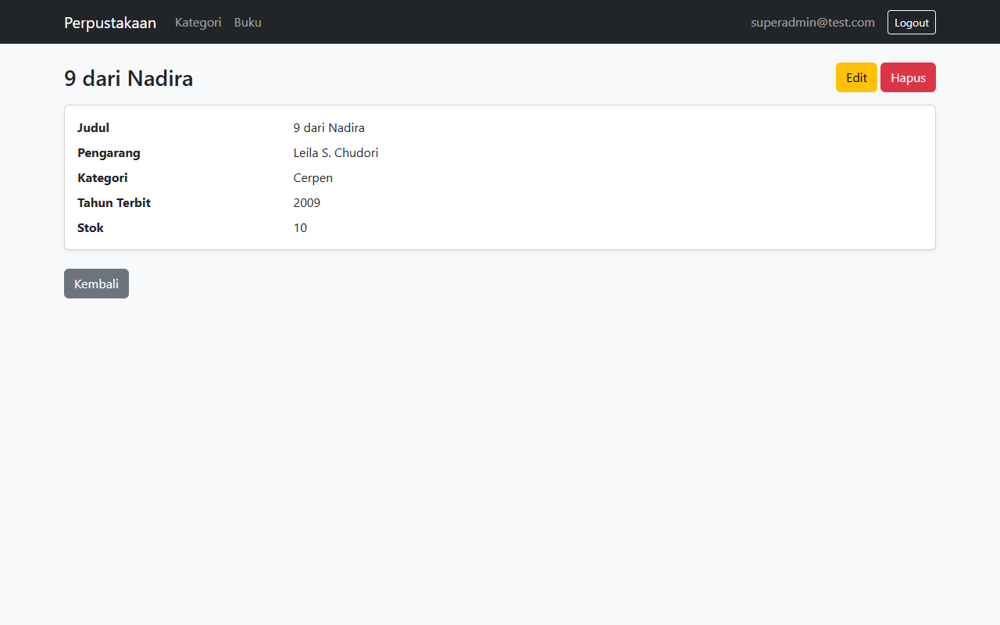
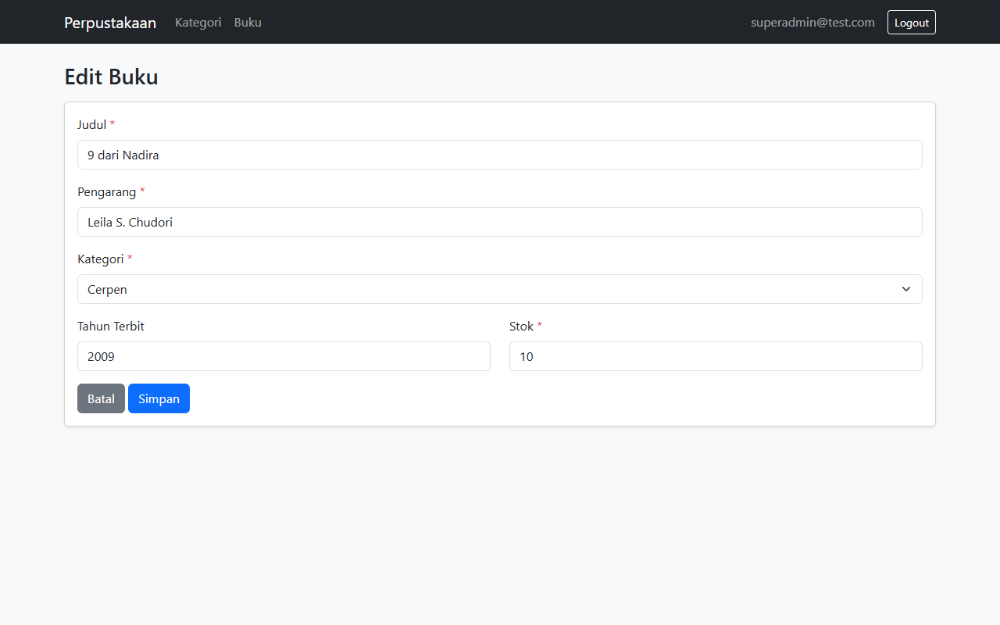
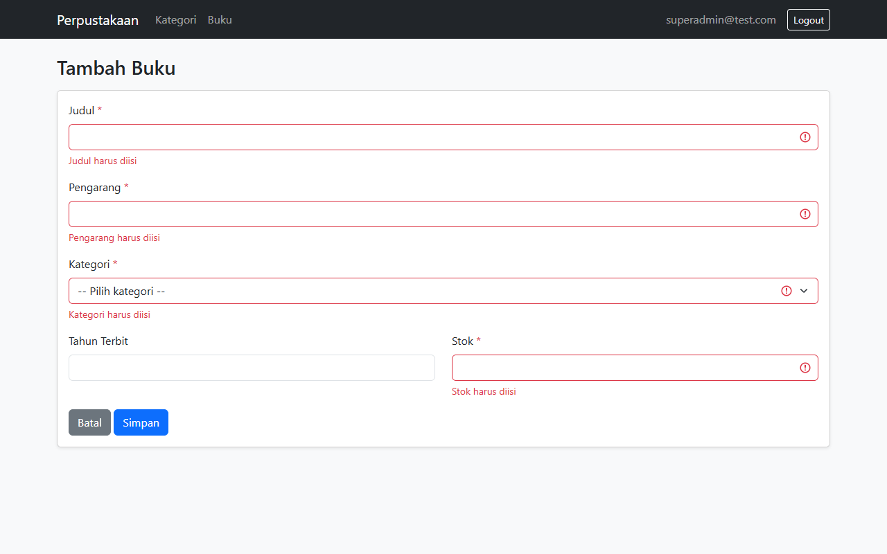
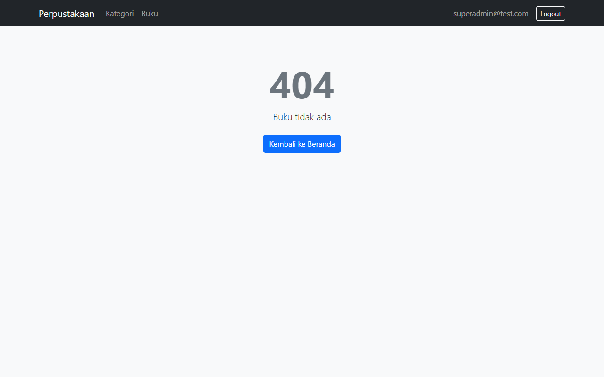
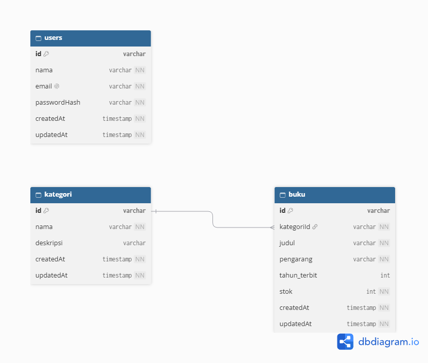

# Admin Panel Perpustakaan

Project ini adalah admin panel untuk mengelola data perpustakaan, yang saya buat untuk Technical Test menggunakan NestJS.

Ada dua data utama yang dikelola, yaitu **kategori** dan **buku**. Satu kategori bisa memiliki banyak buku (relasi one-to-many). Aplikasi dibuat dengan **NestJS**, **Prisma**, dan **PostgreSQL** dengan menggunakan **MVC**, untuk tampilannya memakai **Handlebars** dan **Bootstrap**.

## Fitur

- Login admin menggunakan JWT
- CRUD kategori dan CRUD buku
- Halaman daftar dan halaman detail untuk kategori dan buku
- Pencarian data (kategori berdasarkan nama; buku berdasarkan judul, pengarang, atau kategori)
- Pagination pada halaman daftar
- Validasi form
- Halaman error (misalnya 404) dan respons error JSON untuk API
- REST API untuk semua fitur di atas, yang bisa dites di Postman

## Screenshot

<table>
  <tr>
    <th width="50%">Login</th>
    <th width="50%">Daftar Kategori</th>
  </tr>
  <tr>
    <td></td>
    <td></td>
  </tr>
  <tr>
    <th>Detail Kategori</th>
    <th>Daftar Buku</th>
  </tr>
  <tr>
    <td></td>
    <td></td>
  </tr>
  <tr>
    <th>Detail Buku</th>
    <th>Form Buku</th>
  </tr>
  <tr>
    <td></td>
    <td></td>
  </tr>
  <tr>
    <th>Pencarian</th>
    <th>Validasi Form</th>
  </tr>
  <tr>
    <td></td>
    <td></td>
  </tr>
  <tr>
    <th colspan="2">Halaman Error</th>
  </tr>
  <tr>
    <td colspan="2"></td>
  </tr>
</table>

## Desain Database



Database terdiri dari tiga tabel:

- **users**: menyimpan akun admin untuk login.
- **kategori**: menyimpan kategori buku.
- **buku**: menyimpan data buku. Setiap buku terhubung ke satu kategori melalui `kategoriId`.

Kategori yang masih memiliki buku tidak bisa dihapus.

## Struktur Folder

```
technicaltest-perpus/
├── prisma/
├── src/
│   ├── auth/
│   ├── kategori/
│   ├── buku/
│   ├── prisma/
│   ├── common/
│   └── main.ts
├── views/
│   ├── layouts/
│   ├── partials/
│   ├── auth/
│   ├── kategori/
│   └── buku/
```

| Folder | Isi |
|---|---|
| `prisma/` | Schema database, migration, dan seeder untuk membuat akun admin |
| `src/auth/` | Fitur login: controller, service, dan pengecekan token (guard) |
| `src/kategori/` | Fitur kategori: controller, service, dan validasi data (dto) |
| `src/buku/` | Fitur buku: controller, service, dan validasi data (dto) |
| `src/prisma/` | Koneksi ke database |
| `src/common/` | Kode yang dipakai bersama, yaitu pagination dan penanganan error |
| `src/main.ts` | File yang pertama kali dijalankan, berisi pengaturan aplikasi |
| `views/layouts/` | Kerangka halaman (navbar dan Bootstrap) |
| `views/partials/` | Komponen yang dipakai ulang, misalnya pagination |
| `views/auth/`, `views/kategori/`, `views/buku/` | Tampilan halaman untuk masing-masing fitur |

## Pola MVC

Project ini menggunakan pola MVC (Model, View, Controller). Kodenya dibagi menjadi tiga bagian sesuai tugasnya:

| Bagian | Lokasi | Tugas |
|---|---|---|
| **Model** | `prisma/schema.prisma`, `*.service.ts`, folder `dto/` | Mengurus data: struktur tabel, query ke database, aturan validasi, dan aturan bisnis (misalnya kategori yang masih punya buku tidak boleh dihapus) |
| **View** | folder `views/` (file `.hbs`) | Menampilkan data menjadi halaman HTML |
| **Controller** | `*.controller.ts` | Menerima request, memanggil service, lalu menentukan halaman yang ditampilkan |

Contoh alur saat membuka halaman daftar kategori (`/admin/kategori`):

```
Browser → KategoriController.index()        (Controller)
        → KategoriService.findAll()         (Model, mengambil data lewat Prisma)
        → views/kategori/index.hbs          (View, data ditampilkan dalam tabel)
        → halaman HTML dikirim ke browser
```

Service yang sama juga dipakai oleh API. Misalnya, `GET /kategori` memanggil `KategoriService.findAll()` yang sama, tetapi hasilnya dikirim dalam bentuk JSON, bukan halaman. Dengan begitu, logika data cukup ditulis sekali di service dan dipakai bersama oleh halaman web maupun API.

## Cara Menjalankan

1. Clone repository, lalu install dependency:

   ```bash
   git clone https://github.com/Dhiyun/TechnicalTest-DOT.git
   cd TechnicalTest-DOT
   npm install
   ```

2. Salin `.env.example` menjadi `.env`, lalu isi koneksi database PostgreSQL dan `JWT_SECRET`.

3. Siapkan database dan akun admin:

   ```bash
   npx prisma migrate dev --config prisma7.config.ts
   npx prisma generate --config prisma7.config.ts
   npx prisma db seed --config prisma7.config.ts
   ```

4. Jalankan aplikasi:

   ```bash
   npm run start:dev
   ```

5. Buka http://localhost:3000, lalu login dengan email `superadmin@test.com`. Password-nya ada di `prisma/seed.ts`.

## Dependency

- **NestJS**: framework backend
- **Prisma** + `@prisma/adapter-pg`: ORM untuk PostgreSQL
- **hbs (Handlebars)**: template engine untuk tampilan
- **Bootstrap 5**: styling tampilan (lewat CDN)
- **Zod**: validasi data
- **@nestjs/jwt** dan **bcryptjs**: login dan enkripsi password
- **@nestjs/config** dan **dotenv**: membaca file `.env`

## Informasi untuk Developer Selanjutnya

Kalau ingin melanjutkan project ini, berikut beberapa hal yang bisa membantu:

1. **Mulai dari mana.** Ikuti langkah di bagian Cara Menjalankan. Setelah login, halaman admin bisa dibuka di `/admin/kategori` dan `/admin/buku`.
2. **Letak kode.** Setiap fitur punya folder sendiri di `src/` (`kategori/` dan `buku/`), berisi controller, service, dan dto. Tampilannya ada di folder `views/` dengan nama folder yang sama.
3. **Menambah fitur baru.** Ikuti pola folder `kategori/` atau `buku/`: tambahkan tabel di `prisma/schema.prisma`, lalu buat dto, service, controller, dan view-nya.
4. **API.** Selain halaman web, tersedia API di `/kategori` dan `/buku` yang bisa dicoba lewat Postman. Login dulu lewat `/auth/login` untuk mendapatkan token.
5. **Setelah mengubah database.** Setiap kali `schema.prisma` diubah, jalankan migrate lalu `npx prisma generate --config prisma7.config.ts`.
